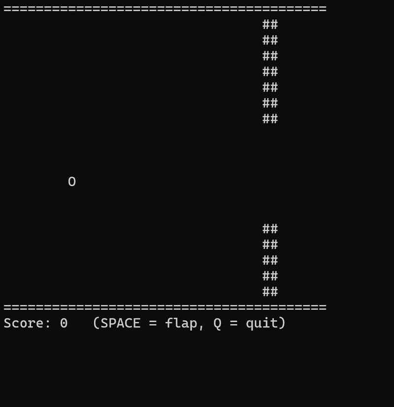
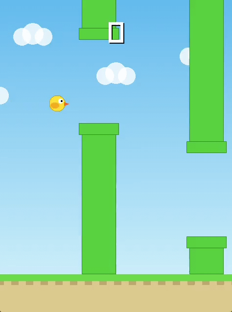
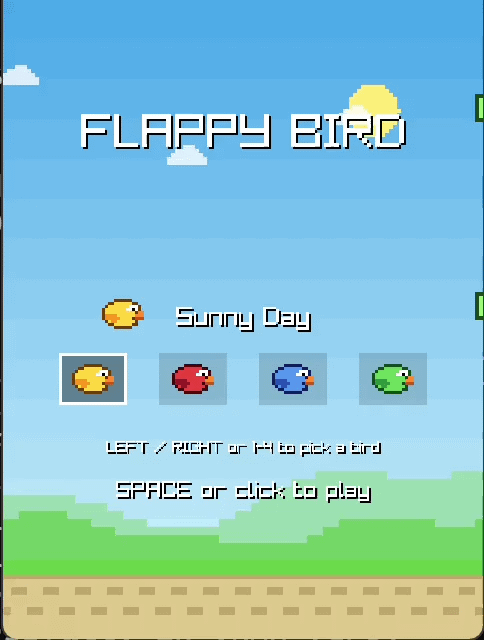

# Flappy Bird — C Game Development

A collection of Flappy Bird implementations developed in C, progressing from a basic game to graphical versions with improved visuals and customization.

**Developer:** A. Rajeshwari  
**Language:** C  
**Graphics:** Console / Custom Graphics / Pixel Art  
**Status:** Ongoing Development 🚧

---

## About the Project

This project is my implementation of the classic Flappy Bird game using C.

It began as a basic C implementation and gradually evolved into graphical versions with improved rendering, visual elements, and customization options.

The repository contains different versions of the game, each representing a stage of development.

---

## Versions

### 1. Basic Flappy Bird — `flappy_bird.c`

The original version of the game, built using basic C programming concepts.

Features:
- Basic gameplay mechanics
- Score tracking
- High-score functionality
- Console-based implementation


### 2. Graphics Integrated Version — `flappy_gfx.c`

The first graphical implementation of the game, introducing custom graphics and a more visually engaging gameplay experience.

Features:
- Graphical rendering
- Improved visual presentation
- Enhanced gameplay experience


### 3. Flappy Pixel — `flappy_pixel.c`

An improved version of the graphical implementation, featuring pixel-style visuals and customizable themes.

Features:
- Pixel-style graphics
- Multiple themes
- Customizable game appearance
- Improved graphical presentation
- Score and high-score tracking


---

## Technologies Used

- C Programming Language
- raylib (for graphical versions)
- Visual Studio Code
- Git
- GitHub

---

## Project Structure

```text
Flappy-Bird/
│
├── flappy_bird.c       # Basic C implementation
├── flappy_gfx.c        # First graphics-integrated version
├── flappy_pixel.c      # Improved version with customizable themes
│
├── README.md           # Project documentation
└── .gitignore          # Git ignore configuration
```

---

## Development

This project is continuously evolving.

Future improvements may include:
- Additional themes and customization options
- Improved animations
- New gameplay features
- Sound effects and music
- Better game menus
- Performance and code improvements

---

## Author

Developed by **A. Rajeshwari**

This project represents my learning journey in C programming, game development, graphics programming, and software design.

---
 Feel free to explore the different versions and follow the project's development <3
